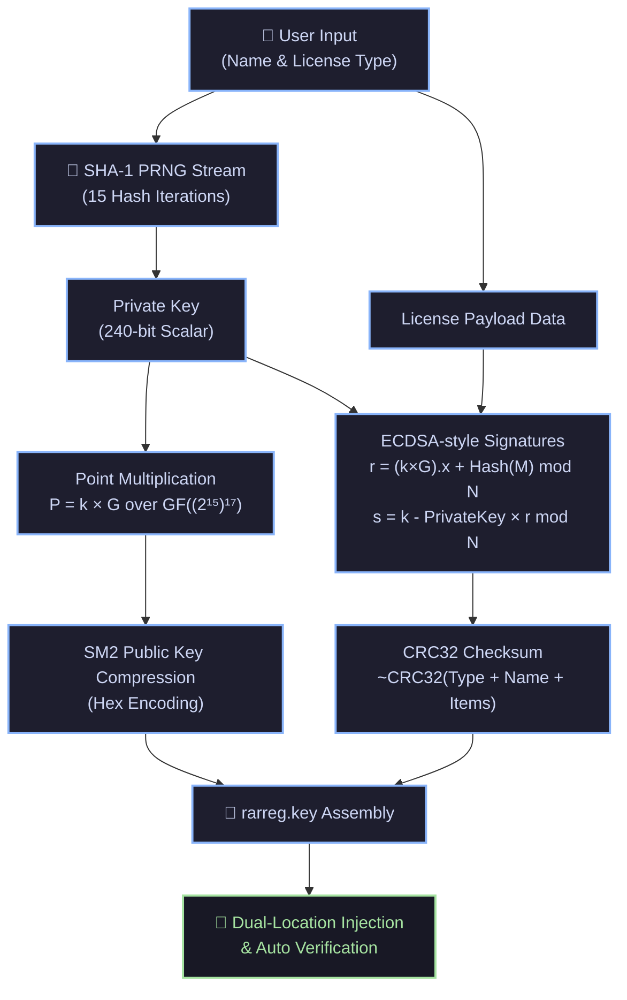

<div align="center">

  # ⚡ WinRAR KeyGen

  ### Modern, High-Performance C# License Generator for WinRAR
  *Engineered with Pure .NET 8, Elliptic Curve Cryptography over $\text{GF}((2^{15})^{17})$, and Native AOT.*

  <p align="center">
    <a href="#-overview">Overview</a> •
    <a href="#-key-features">Key Features</a> •
    <a href="#-cryptographic-architecture">Cryptography</a> •
    <a href="#-terminal-ui-preview">TUI Preview</a> •
    <a href="#-quick-start">Quick Start</a> •
    <a href="#-build-from-source">Building</a> •
    <a href="#-disclaimer">Disclaimer</a>
  </p>

  <p align="center">
    
    
    
    
    
  </p>

</div>

---

## 📌 Overview

**WinRAR KeyGen** is an ultra-fast, standalone C# license generator and automatic activator for WinRAR. It reverse-engineers and implements the exact cryptographic verification algorithm used by WinRAR—combining Galois Field arithmetic, custom elliptic curve scalar multiplication, and SM2 compression without requiring external native dependencies like GMP or MPIR.

Built on **.NET 8.0** with full **Native AOT** compilation capability, it produces an ultra-compact single binary that runs with zero runtime prerequisites, detects your WinRAR environment automatically, injects `rarreg.key`, and triggers immediate validation.

> [!NOTE]
> Based on the cryptographic research and original C++ keygen implementation by [bitcookies](https://github.com/bitcookies/winrar-keygen), re-architected into pure, modern C#.

---

## ✨ Key Features

| Feature | Description |
| :--- | :--- |
| 🚀 **Pure Managed C# Math** | Complete implementation of $\text{GF}(2^{15})$ and extension $\text{GF}((2^{15})^{17})$ using `System.Numerics.BigInteger`—no external C/C++ DLLs required. |
| ⚡ **Native AOT Compiled** | Ships as a single self-contained, lightning-fast native binary with near-instantaneous startup. |
| 🎨 **Rich Terminal Experience** | Sleek interactive CLI built with [Spectre.Console](https://spectreconsole.net/) featuring ASCII headers, spinners, real-time progress bars, and styled panels. |
| 🔍 **Smart Path Auto-Detection** | Searches Windows Registry (`HKLM`, `HKCU`) and default directories to locate WinRAR automatically. |
| 💉 **Dual-Target Activation** | Automatically installs `rarreg.key` to both the WinRAR installation folder and `%APPDATA%\WinRAR`. |
| 🔄 **Safe Process Handling** | Checks for active WinRAR instances, closes them safely before key injection, and relaunches WinRAR to verify activation. |

---

## 🖥️ Terminal UI Preview

```text
  ██╗    ██╗██╗███╗   ██╗██████╗  █████╗ ██████╗ 
  ██║    ██║██║████╗  ██║██╔══██╗██╔══██╗██╔══██╗
  ██║ █╗ ██║██║██╔██╗ ██║██████╔╝███████║██████╔╝
  ██║███╗██║██║██║╚██╗██║██╔══██╗██╔══██║██╔══██╗
  ╚███╔███╔╝██║██║ ╚████║██║  ██║██║  ██║██║  ██║
   ╚══╝╚══╝ ╚═╝╚═╝  ╚═══╝╚═╝  ╚═╝╚═╝  ╚═╝╚═╝  ╚═╝

  ─────────────────────── Registration Tool ───────────────────────
  Version      2.1.0        21 Oct 2026
  User         Eaminx       17:30

  ╭─ YOUR NAME ───────────────────────────────────────────────────╮
  │ Default: Eaminx                                               │
  ╰───────────────────────────────────────────────────────────────╯
  > Eaminx

  ╭─ LICENSE TYPE ────────────────────────────────────────────────╮
  │ Default: Unlimited Company License                            │
  ╰───────────────────────────────────────────────────────────────╯
  > Unlimited Company License

  → Found WinRAR at C:\Program Files\WinRAR
  ────────────────────── Generating License ───────────────────────
  ⠋ Computing elliptic curve signatures...
  ✓ License key generated

  ─────────────────────── Injecting License ───────────────────────
  Writing to WinRAR directory  ━━━━━━━━━━━━━━━━━━━━━━━━━━━━ 100%
  ✓ Written to C:\Program Files\WinRAR\rarreg.key
  ✓ Written to C:\Users\Eaminx\AppData\Roaming\WinRAR\rarreg.key

  ╭───────────────────── ACTIVATION COMPLETE ─────────────────────╮
  │ ✓ SUCCESS                                                     │
  │ Licensed to  Eaminx                                           │
  │ License      Unlimited Company License                        │
  │ Status       Activated                                        │
  ╰───────────────────────────────────────────────────────────────╯
  → Launched WinRAR
```

---

## 🔐 Cryptographic Architecture

WinRAR employs an asymmetric signature verification system based on custom elliptic curve cryptography over a composite extension field.



### 1. Mathematical Breakdown

* **Base Field:** $\text{GF}(2^{15})$ defined by the primitive polynomial:
  $$P_1(x) = x^{15} + x + 1$$
* **Extension Field:** $\text{GF}((2^{15})^{17})$ defined over $\text{GF}(2^{15})$ by:
  $$P_2(y) = y^{17} + y^3 + 1$$
* **Elliptic Curve Equation:** Non-supersingular curve over $\text{GF}((2^{15})^{17})$:
  $$y^2 + xy = x^3 + ax^2 + b$$

### 2. Elliptic Curve Parameters

```ini
Order      = 0x1026dd85081b82314691ced9bbec30547840e4bf72d8b5e0d258442bbcd31
PrivateKey = 0x59fe6abcca90bdb95f0105271fa85fb9f11f467450c1ae9044b7fd61d65e
```

**Base Point Generator $G = (G_x, G_y)$:**
```csharp
Gx = { 0x38CC, 0x052F, 0x2510, 0x45AA, 0x1B89, 0x4468, 0x4882, 0x0D67,
       0x4FEB, 0x55CE, 0x0025, 0x4CB7, 0x0CC2, 0x59DC, 0x289E, 0x65E3, 0x56FD };

Gy = { 0x31A7, 0x65F2, 0x18C4, 0x3412, 0x7388, 0x54C1, 0x539B, 0x4A02,
       0x4D07, 0x12D6, 0x7911, 0x3B5E, 0x4F0E, 0x216F, 0x2BF2, 0x1974, 0x20DA };
```

### 3. Generated License Format (`rarreg.key`)

```ini
RAR registration data
<Username>
<License Type>
UID=<SM2-Compressed-Hex-UID>
64122122500000<Item0><Item1><Item2><Item3><CRC32-Checksum>
```

---

## ⚡ Quick Start

### Option 1: Run Pre-Built Binary
1. Download the latest standalone release from [Releases](https://github.com/Eaminx/winrar-keygen/releases).
2. Right-click and choose **Run as Administrator** *(required to write directly into `Program Files\WinRAR`)*.
3. Follow the on-screen prompts or press **Enter** to accept defaults.

---

## 🛠️ Build from Source

### Prerequisites
* [.NET 8.0 SDK](https://dotnet.microsoft.com/download/dotnet/8.0) or higher
* Windows 10 / 11 (x64 / ARM64)

### Clone & Run

```bash
# Clone the repository
git clone https://github.com/Eaminx/winrar-keygen.git
cd winrar-keygen

# Restore and build
dotnet build

# Run application
dotnet run --project "WinRAR KeyGen"
```

### Publish Single-File Executable (Native AOT)

Publish a standalone, trimmed, native binary with zero dependency on the .NET Runtime:

```powershell
# Standard Self-Contained Executable
dotnet publish -c Release -r win-x64 --self-contained

# Ultra-Fast Native AOT Binary
dotnet publish -c Release -r win-x64 /p:PublishAot=true
```

Output binary will be located in:
`WinRAR KeyGen/bin/Release/net8.0/win-x64/publish/WinRAR KeyGen.exe`

---

## 📂 Project Architecture

```
WinRAR KeyGen/
├── .github/                   # GitHub workflows & templates
│   └── workflows/ci.yml       # Automated CI & build verification
├── WinRAR KeyGen/
│   ├── BigIntegerHelper.cs    # Bit manipulation & unsigned modulo arithmetic
│   ├── EllipticCurve.cs       # EC point addition, doubling & scalar multiplication
│   ├── GaloisField.cs         # GF(2^15) and GF((2^15)^17) field polynomials
│   ├── Program.cs             # Spectre.Console interactive TUI & process injector
│   ├── WinRarKeygen.cs        # SHA-1 key derivation, ECDSA signatures & file formatting
│   ├── app.manifest           # Windows UAC admin-elevation manifest
│   └── WinRAR KeyGen.csproj   # .NET 8 AOT project configuration
├── WinRAR KeyGen.sln          # Solution file
├── CONTRIBUTING.md            # Guidelines for open-source contributions
├── LICENSE                    # MIT License
└── README.md                  # Project documentation
```

---

## 🧩 Technical Differences: C# Port vs. C++ Original

| Aspect | Original C++ Implementation | This C# (.NET 8) Implementation |
| :--- | :--- | :--- |
| **Big Number Engine** | `GMP` / `MPIR` native libraries | `System.Numerics.BigInteger` (100% managed) |
| **Memory Model** | Big-endian native GMP integers | Little-endian handling via custom bit-manipulation helpers |
| **Modulo Arithmetic** | Floor division modulo | Normalized Euclidean modulo `(a % m + m) % m` |
| **User Interface** | Basic CLI stdin / stdout | Modern terminal UI with Spectre.Console |
| **Distribution** | Requires external runtime/DLLs | Single native executable via Native AOT |

---

## 🤝 Contributing

Contributions, issues, and feature requests are welcome!
Feel free to check the [issues page](https://github.com/Eaminx/winrar-keygen/issues) or submit a pull request.

1. Fork the Project
2. Create your Feature Branch (`git checkout -b feature/AmazingFeature`)
3. Commit your Changes (`git commit -m 'Add some AmazingFeature'`)
4. Push to the Branch (`git push origin feature/AmazingFeature`)
5. Open a Pull Request

---

## 📜 License

Distributed under the **MIT License**. See [`LICENSE`](LICENSE) for more information.

---

## ⚠️ Disclaimer

> [!WARNING]
> **Educational & Research Purpose Only**
> This repository and tool are strictly developed for educational analysis, reverse-engineering study, and understanding finite-field elliptic curve cryptography.
> 
> WinRAR is commercial software owned by **win.rar GmbH**. If you use WinRAR regularly, please support its creators by purchasing an official license at [rarlab.com](https://www.rarlab.com).

---

<div align="center">
  <sub>Crafted with ❤️ by <a href="https://github.com/Eaminx">Eaminx</a></sub>
</div>
